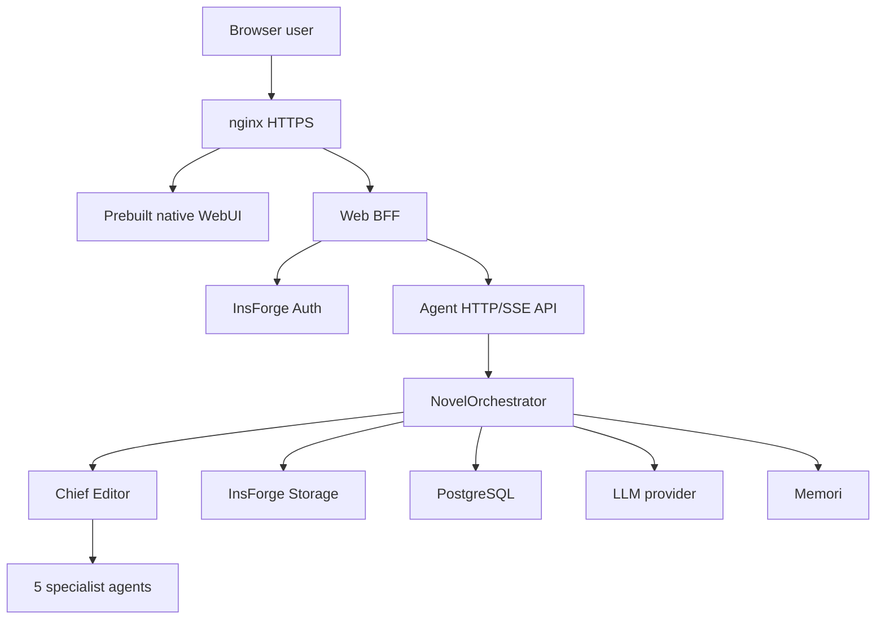

# Novel Vibe Architecture

## Overview

Novel Vibe is a SaaS application for collaborative web-novel generation. A native React WebUI talks to an authenticated Web BFF, which delegates domain work to the Agent Server. Agent Core and InsForge remain server-side so users share one controlled runtime and no model or database secrets reach the browser.

## System Diagram

## Components

### Native WebUI

`packages/novel-webui` is the only supported frontend source. It is a Vite/React SPA with project navigation, Chief Editor chat, document browsing, and document editing. It uses browser `fetch` and SSE parsing against same-origin APIs.

Production servers do not build frontend assets. `make build-webui-dist` runs locally and commits the output under `webui-dist`.

### Web BFF

`packages/novel-web` owns the browser security boundary:

- authenticates credentials against InsForge;
- stores access tokens in a server-side session;
- sends only an opaque HTTP-only cookie to the browser;
- enforces authentication before proxying projects, documents, skills, credits, and chat;
- forwards streaming chat responses without exposing the Agent Server.

### Agent Server

`packages/novel-agents/server.ts` exposes internal HTTP and SSE endpoints. It validates user/project ownership before creating projects, reading or changing documents, and starting agent work.

`NovelOrchestrator` creates the Chief Editor and five specialist agents using pi. Tool factories receive `ToolContext`, which contains project-scoped Storage and database clients.

### Skill safety boundary

User Skills are single-file Markdown instructions, not executable packages. Uploads and `/skill-creator` output enter an owner-scoped draft, deterministic validation, isolated semantic review, diff confirmation, and only then the installed registry. Runtime loading fails closed unless the Skill remains approved for the active policy, enabled in the project, assigned to the current Agent role, compatible with its platform capabilities, and byte-identical to the reviewed SHA-256 hash. The Agent's configured tool list remains the final permission boundary.

### InsForge

InsForge provides authentication, S3-compatible Storage, PostgreSQL/PostgREST, and the AI gateway. Application code treats Markdown Storage as authoritative and database indexes as rebuildable query surfaces.

## Authentication Flow

1. The browser submits credentials to the BFF.
2. The BFF authenticates with InsForge.
3. The BFF stores the returned access token in its server-side session store.
4. The browser receives an opaque, signed, HTTP-only cookie.
5. Protected browser requests resolve the session and pass the real token only over the internal network.

## Document Flow

1. The WebUI requests project documents from the BFF.
2. The BFF forwards the authenticated request to the Agent Server.
3. The Agent Server checks ownership and reads or writes Storage.
4. Writes parse YAML frontmatter and synchronize PostgreSQL indexes.
5. Deletions remove Storage content and related indexes, including foreshadow rows.

## Deployment Boundary

Only nginx ports 80 and 443 are public. The Web BFF, Agent Server, InsForge, PostgreSQL, and Storage communicate on internal Docker networks. nginx serves static assets and proxies `/login`, `/health`, and `/api/*` to the Web BFF.

The artifact preflight (part of the hosted release pipeline, which lives in the private ops repository) validates the native marker in the generated `webui-dist/index.html` and rejects desktop-only runtime markers before the build is released. A self-hoster produces the same artifact with `make build-webui-dist` — see [self-hosting.md](self-hosting.md).

## Failure Boundaries

- If the BFF session is absent or expired, browser APIs return `401` and the WebUI returns to login.
- If the Agent Server is unavailable, the BFF returns an upstream failure without exposing internal addresses.
- If an SSE connection ends, the WebUI preserves the completed events and surfaces the interrupted request.
- If a database index disagrees with Storage, Storage wins and indexes must be synchronized.
- If prebuilt frontend output is missing or invalid, deployment stops before service replacement.

## Architectural Constraints

- Agent Core and InsForge remain server-side.
- Browser code never receives database, storage, model-provider, or signing secrets.
- New frontend behavior belongs in `packages/novel-webui/src`.
- New browser-facing operations must cross the BFF authentication boundary.
- Keep browser transport on HTTP/SSE unless a concrete bidirectional realtime requirement appears.
