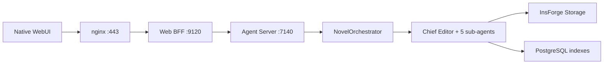

# Novel Vibe Current System Map

This document describes the supported production system as of 2026-06-27.

## Ownership Boundaries

| Path | Responsibility |
| --- | --- |
| `packages/novel-webui/` | Native React browser interface |
| `packages/novel-web/` | Browser login, opaque cookie sessions, authenticated API/SSE proxy |
| `packages/novel-agents/` | Agent orchestration, document APIs, tools, prompts, and schemas |
| `webui-dist/` | Generated prebuilt production frontend (build output; not committed to the open-source tree) |
| `InsForge/` | Auth, PostgreSQL, Storage, and AI gateway infrastructure (cloned from the public fork by `make setup`) |
| `@earendil-works/pi-agent-core`, `@earendil-works/pi-ai` | Agent runtime and model APIs installed from npm |
| `Memori/` | Agent session memory dependency |

## Runtime Services

| Service | Port | Exposure |
| --- | ---: | --- |
| nginx | `80`, `443` | Public production entrypoint |
| InsForge API | `7130` | Internal in production; localhost in development |
| InsForge Dashboard | `7131` | Administrative access |
| PostgREST | `5430` | Internal database API |
| Agent Server | `7140` | Internal application API |
| Web BFF | `9120` | Internal browser facade |
| WebUI dev server | `5173` | Local development only |

## Request Flow

The browser never calls the Agent Server or InsForge directly. The BFF authenticates the user, stores the InsForge access token server-side, and passes authenticated identity to the internal APIs.

## Data Ownership

Markdown files under `novels/{project_id}/...` in InsForge Storage are the source of truth. PostgreSQL `document_index`, `foreshadow_index`, and task/session tables provide query and workflow state.

Document status follows `draft -> confirmed -> locked`. Only the Chief Editor changes status after user approval.

## Agent Layer

`packages/novel-agents/agents.ts` creates the live `NovelOrchestrator` and six pi Agent instances.

| Agent | Responsibility |
| --- | --- |
| `chief_editor` | User-facing coordination, review, and approval |
| `worldbuilder` | World settings and rules |
| `character_designer` | Characters and relationships |
| `outliner` | Volumes, chapter cards, and foreshadowing |
| `director` | Chapter direction scripts |
| `writer` | Chapter prose |

The Chief Editor delegates by invoking sub-agent prompts directly. Sub-agent deletion calls are blocked by `beforeToolCall`; deletion requests return to the Chief Editor for approval.

## Supported APIs

The browser-facing routes live in `packages/novel-web`. The internal document, project, credit, skill, and chat routes live in `packages/novel-agents/server.ts`. Chat responses stream over SSE.

Skill installation is a reviewed lifecycle: `/api/skill-drafts` creates owner-scoped candidates, review endpoints run the policy engine, confirmation binds the exact version/hash, and `/api/workspaces/:id/skills` controls project enablement. `/api/skills/install` and remote repository installation are intentionally unsupported.

The frontend uses same-origin `/login`, `/health`, and `/api/*` requests. Production nginx serves `webui-dist` and proxies those dynamic routes to the BFF.
